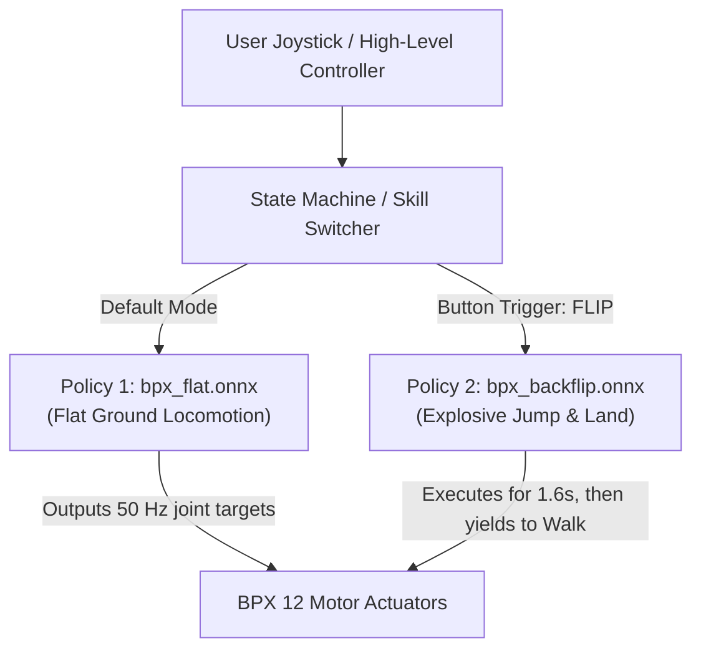

# Backflips and Multi-Skill Composition for the BPX Quadruped

This document explains the physical and mathematical challenges of training acrobatic maneuvers (such as backflips), outlines three architectural solutions for composing multiple robot skills, details the progressive gravity curriculum, and explains how to run the dedicated `tasks/acrobatics/` package.

---

## 1. Why Walking and Backflips Cannot Share a Single Naive Objective

In supervised learning, training a single model on contradictory losses causes gradient interference:
$$\nabla_\theta \mathcal{L}_{\text{total}} = \nabla_\theta \mathcal{L}_{\text{walk}} + \nabla_\theta \mathcal{L}_{\text{flip}} \approx 0$$

In legged robotics, the physical objectives of walking and backflips directly conflict:

| Metric | Flat Walking (`bpx_flat`) | Backflip (`bpx_backflip`) | Conflict |
|---|---|---|---|
| **Pitch Orientation** | Torso must stay level ($R_{\text{flat}} \to 1$, tilt $< 15^\circ$) | Torso must rotate $360^\circ$ around the Y-axis | **Direct contradiction**: Walking terminates if tilt exceeds $65^\circ$. |
| **Vertical Velocity ($v_z$)** | Heavily penalized (`lin_vel_z_l2`, weight $-1.0$) to prevent bouncing | Maximized during takeoff ($+v_z > 2.0\text{ m/s}$) to achieve flight | **Direct contradiction**: Penalizing $v_z$ suppresses takeoff thrust. |
| **Torso Height** | Kept strictly at $0.48\text{ m}$ above ground | Must exceed $0.75\text{ m}$ at apex | Walking reward actively pulls robot down. |
| **Time Horizon** | Infinite horizon (continuous $20\text{ s}$ locomotion) | Finite episodic event ($1.2\text{ s} - 1.6\text{ s}$) | Walking is cyclic/stationary; flip has discrete non-reversible phases. |

Attempting to train a single unconditioned policy on both objectives results in a robot that neither walks nor jumps.

---

## 2. Architectural Solutions for Multi-Skill Robots

To support both locomotion and acrobatic skills on physical hardware, roboticists use three standard patterns:

### Solution 1: State Machine of Specialized Policies (Industry Standard)

Used by commercial quadruped systems (such as Boston Dynamics Spot and Unitree):



* **Concept**: Train `bpx_flat` and `bpx_backflip` as separate tasks in Isaac Lab.
* **Onboard Deployment**: The C++ onboard software loads both `bpx_flat.onnx` and `bpx_backflip.onnx`.
* **Execution**: Walking runs continuously. When the user commands a backflip, execution switches to `bpx_backflip.onnx` for $1.6\text{ s}$. Once the feet touch down upright, execution smoothly transitions back to `bpx_flat.onnx`.

---

### Solution 2: Command-Conditioned Multi-Task Policy

Analogous to prompt-conditioning in language models:

* **Observation**: Add a discrete one-hot skill mode vector to the input:
  * Mode `[1, 0]`: Locomotion mode.
  * Mode `[0, 1]`: Backflip mode.
* **Reward Masking in Simulation**:
  $$\mathcal{R}_{\text{step}} = c_{\text{walk}} \cdot \mathcal{R}_{\text{walk}} + c_{\text{flip}} \cdot \mathcal{R}_{\text{flip}}$$
* **Trade-off**: Requires a larger neural network capacity to prevent catastrophic forgetting of walking gaits during high-torque jump exploration.

---

### Solution 3: Hierarchical Reinforcement Learning

A two-level control architecture:
* **Low-Level Skills**: A frozen library of specialized policies (`walk`, `backflip`, `stairs`, `crawl`).
* **High-Level Manager**: A neural network running at $5\text{ Hz}$ that selects which low-level skill to activate based on terrain and mission commands.

---

## 3. Dedicated `tasks/acrobatics/` Module Architecture

Rather than modifying `tasks/locomotion/`, acrobatic maneuvers are isolated into a parallel task package under `tasks/acrobatics/`:

```text
source/mirrorme_rl_train/mirrorme_rl_train/tasks/
├── __init__.py                        <-- [1 line]: from . import acrobatics
├── locomotion/                        <-- 100% UNTOUCHED (Zero modifications!)
│   ├── __init__.py                    <-- gym.register("bpx_flat")
│   ├── bpx_flat_env_cfg.py
│   ├── mdp/
│   │   ├── __init__.py
│   │   └── rewards.py
│   └── agents/
│       ├── __init__.py
│       └── rsl_rl_ppo_cfg.py
│
└── acrobatics/                        <-- [NEW PARALLEL PACKAGE]
    ├── __init__.py                    <-- gym.register("bpx_backflip")
    ├── bpx_backflip_env_cfg.py        <-- Self-contained Backflip MDP, Rewards, & Curriculum
    └── agents/
        ├── __init__.py
        └── rsl_rl_ppo_cfg.py          <-- BPXBackflipPPORunnerCfg
```

### Why a Parallel Package is Superior
1. **Zero Regression Risk**: `tasks/locomotion/` is completely untouched. There is no risk of breaking walking hyper-parameters, reward balances, or contracts.
2. **True Domain Separation**:
   * `locomotion/`: Continuous transport (walking, trotting, turning, climbing).
   * `acrobatics/`: Dynamic maneuvers (backflips, forward flips, rolls, high jumps).
3. **Completely Pluggable & Modular**: To add or remove stunts, you only touch `acrobatics/` without interfering with core locomotion.

---

## 4. Key Components of `bpx_backflip_env_cfg.py`

### 4.1 Preserving the 45-D / 48-D Contract
To ensure standard verification tools (`inspect_contract.py`) and export scripts (`export_policy.py`) work seamlessly without modification, the backflip policy maintains the exact same observation and action dimensions:
* **Action (12-D)**: 12 motor position residuals ($q = q_{\text{default}} + 0.25 \cdot a$).
* **Actor Observation (45-D)**:
  * Base angular velocity (3D)
  * Projected gravity (3D)
  * **Phase Clock (3D)**: $[\sin(2\pi \cdot \text{phase}), \cos(2\pi \cdot \text{phase}), 1.0]$ where $\text{phase} = \frac{t}{1.6\text{s}} \in [0, 1]$
  * Joint positions relative to default (12D)
  * Joint velocities (12D)
  * Previous action (12D)
* **Critic Observation (48-D)**: The 45-D Actor input + privileged base linear velocity $(v_x, v_y, v_z)$.

### 4.2 Phase-Gated Reward Formulation
Because a backflip requires distinct chronological phases, the reward terms are gated by the internal phase clock:

1. **Takeoff Thrust ($\text{phase} < 0.35$)**:
   Rewards explosive vertical linear velocity $+v_z > 2.0\text{ m/s}$ while rear legs extend.
2. **Pitch Angular Rotation ($\text{phase} < 0.75$)**:
   Rewards backward angular rate around the base Y-axis ($-\omega_y > 7.0\text{ rad/s}$).
3. **Flight Apex Clearance ($0.25 \le \text{phase} < 0.80$)**:
   Rewards torso height exceeding $0.70\text{ m}$ off the ground.
4. **Upright Landing ($\text{phase} \ge 0.80$)**:
   Rewards foot ground contact combined with an upright gravity vector ($g_z \approx -1.0$).

### 4.3 Progressive Gravity Curriculum (Mars $\to$ Earth)
To prevent the robot from repeatedly falling before discovering the $360^\circ$ rotation, the environment includes a **Gravity Curriculum** (`BackflipCurriculumCfg`):

$$
g_{\text{eff}}(\text{iteration}) = -4.90 - 4.91 \times \min\left(1.0, \frac{\text{iteration}}{3000}\right)
$$

* **Iterations 0 – 1,000 (Mars Gravity: $-4.90\text{ m/s}^2$)**: The robot experiences buoyant assistance, remaining aloft longer with less effort to easily discover the tuck and rotation mechanics.
* **Iterations 1,000 – 3,000 (Ramping to Earth)**: Upward assistance steadily decays to $0.0\text{ N}$, compelling the policy to generate progressively more explosive leg thrust to maintain apex clearance.
* **Iterations 3,000 – 5,000 (Full Earth Gravity: $-9.81\text{ m/s}^2$)**: The policy fine-tunes high-torque takeoff and landing stability under unassisted physics.

### 4.4 Termination Adjustments
* **Disabled**: The standard locomotion $65^\circ$ body tilt kill-switch (`bad_orientation`) is omitted to permit complete $360^\circ$ rotation.
* **Preserved**: Early torso impact termination is maintained to abort runs that collapse during initial takeoff.

---

## 5. Training Budget & CLI Usage

### 5.1 Training Hyperparameters

| Setting | Value | Notes |
|---|---|---|
| **Parallel Environments** | `4096` | Full GPU batch: $4096 \times 24 = 98,304$ samples per iteration |
| **Max Iterations** | `5000` | Sufficient for finite 1.6s stunt (vs. 10,000 for continuous 20s walking) |
| **Episode Length** | `1.6 s` | 80 policy control steps at 50 Hz |
| **Wall-Clock Time** | ~15–25 minutes | On an NVIDIA L4 GPU instance on GCP |

### 5.2 Commands

* **Quick Smoke Test (Verifies GPU simulator & rewards in ~1 minute)**:
  ```bash
  ./bpx.sh train --task bpx_backflip --num_envs 64 --max_iterations 20 --headless
  ```

* **Full Backflip Training Run**:
  ```bash
  ./bpx.sh train --task bpx_backflip --run_name backflip_baseline --headless
  ```

* **Monitor with TensorBoard**:
  ```bash
  tensorboard --logdir logs/bpx_backflip
  ```

* **Interactive Playback / Visual Inspection**:
  ```bash
  ./bpx.sh play --checkpoint logs/bpx_backflip/<run>/model_4999.pt
  ```

* **Export Deployment Policy to ONNX / TorchScript**:
  ```bash
  ./bpx.sh export --checkpoint logs/bpx_backflip/<run>/model_4999.pt
  ```
