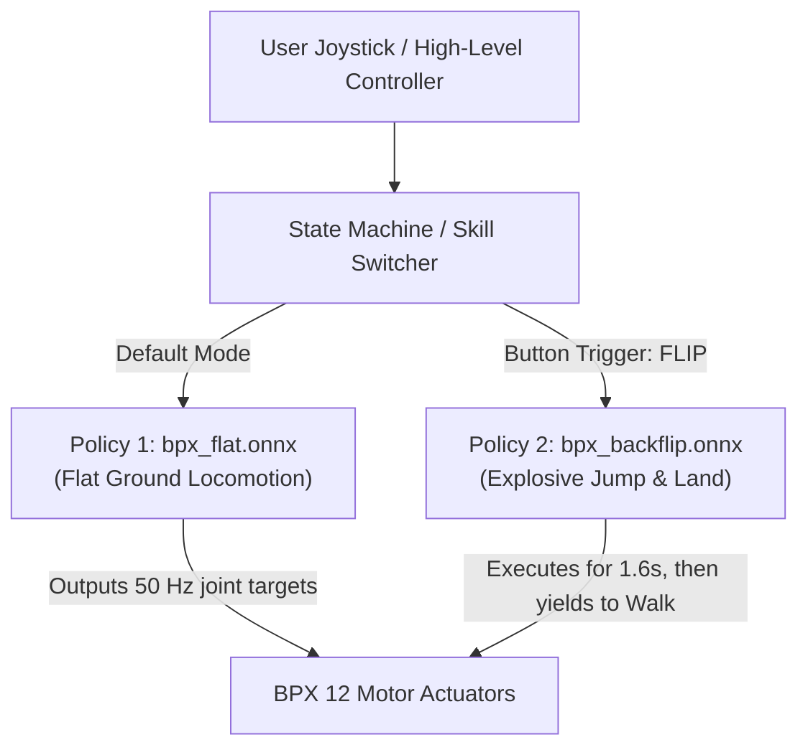

# Backflips: Training Architecture, Rewards, and Curriculum for the BPX Quadruped

This repository focuses on **training the standalone `bpx_backflip` acrobatic policy** in Isaac Lab. This document details the physical challenges of backflips, explains the dedicated `tasks/acrobatics/` architecture, formulates the precision rewards and bilateral symmetry constraints, describes the transition-based auto-scaling curriculum, and provides CLI instructions for training and deployment export.

---

## 1. Why Walking and Backflips Cannot Share a Single Naive Objective

In supervised learning, training a single model on contradictory losses causes gradient interference:

$$
\nabla_\theta \mathcal{L}_{\text{total}} = \nabla_\theta \mathcal{L}_{\text{walk}} + \nabla_\theta \mathcal{L}_{\text{flip}} \approx 0
$$

In legged robotics, the physical objectives of walking and backflips directly conflict:

| Metric | Flat Walking (`bpx_flat`) | Backflip (`bpx_backflip`) | Conflict |
|---|---|---|---|
| **Pitch Orientation** | Torso must stay level ($R_{\text{flat}} \to 1$, tilt $< 15^\circ$) | Torso must rotate $360^\circ$ around the Y-axis | **Direct contradiction**: Walking terminates if tilt exceeds $65^\circ$. |
| **Vertical Velocity ($v_z$)** | Heavily penalized (`lin_vel_z_l2`, weight $-1.0$) to prevent bouncing | Maximized during takeoff ($+v_z > 2.0\text{ m/s}$) to achieve flight | **Direct contradiction**: Penalizing $v_z$ suppresses takeoff thrust. |
| **Torso Height** | Kept strictly at $0.48\text{ m}$ above ground | Must exceed $0.70\text{ m}$ at apex | Walking reward actively pulls robot down. |
| **Time Horizon** | Infinite horizon (continuous $20\text{ s}$ locomotion) | Finite episodic event ($1.6\text{ s}$) | Walking is cyclic/stationary; flip has discrete non-reversible phases. |

Attempting to train a single unconditioned policy on both objectives results in a robot that neither walks nor jumps.

---

## 2. Multi-Skill Composition (Conceptual Reference)

> [!NOTE]
> **Scope Clarification**: The composition architectures below are conceptual reference patterns for downstream deployment on the physical robot. They are **not implemented in this repository**. This repository strictly focuses on training the independent, high-performance `bpx_backflip` policy.

When integrating both locomotion and acrobatics into an onboard production robot, engineering teams typically choose one of three downstream deployment patterns:

### Solution 1: State Machine of Specialized Policies (Industry Standard Pattern)

Used by commercial quadruped systems (such as Boston Dynamics Spot and Unitree):



* **Concept**: Train `bpx_flat` and `bpx_backflip` as completely separate, decoupled tasks in Isaac Lab (which this repository does).
* **Downstream Deployment**: The onboard C++ execution loop loads both exported `bpx_flat.onnx` and `bpx_backflip.onnx` engines.
* **Switching Logic**: Locomotion runs by default. When the operator triggers the backflip action, control yields to `bpx_backflip.onnx` for $1.6\text{ s}$ ($80$ control ticks). Once the policy hits its stabilized stance, control transitions back to `bpx_flat.onnx`.

---

### Solution 2: Command-Conditioned Multi-Task Policy (Alternative Architecture)

Analogous to prompt-conditioning in language models:
* Adds a discrete skill mode vector to the policy observation (e.g. `[1, 0]` for walk, `[0, 1]` for flip).
* In simulation, masks reward terms according to the commanded mode:

$$
\mathcal{R}_{\text{step}} = c_{\text{walk}} \cdot \mathcal{R}_{\text{walk}} + c_{\text{flip}} \cdot \mathcal{R}_{\text{flip}}
$$

* Requires a substantially larger neural network to avoid catastrophic forgetting of walking gaits during high-torque explosive exploration.

---

### Solution 3: Hierarchical Reinforcement Learning (Alternative Architecture)

A two-level control framework where a low-frequency ($5\text{ Hz}$) planner network selects between frozen low-level policy primitives (`walk`, `backflip`, `stairs`, `crawl`) based on terrain perception.

---

## 3. Dedicated `tasks/acrobatics/` Module Architecture

Rather than modifying `tasks/locomotion/`, acrobatic maneuvers are isolated into a parallel task package under `tasks/acrobatics/`:

```text
source/mirrorme_rl_train/mirrorme_rl_train/tasks/
├── __init__.py                        <-- [1 line]: from . import acrobatics
├── locomotion/                        <-- 100% UNTOUCHED (Zero modifications!)
│   ├── __init__.py                    <-- gym.register("bpx_flat")
│   ├── bpx_flat_env_cfg.py
│   ├── mdp/
│   │   ├── __init__.py
│   │   └── rewards.py
│   └── agents/
│       ├── __init__.py
│       └── rsl_rl_ppo_cfg.py
│
└── acrobatics/                        <-- [NEW PARALLEL PACKAGE]
    ├── __init__.py                    <-- gym.register("bpx_backflip")
    ├── bpx_backflip_env_cfg.py        <-- Self-contained Backflip MDP, Rewards, & Curriculum
    └── agents/
        ├── __init__.py
        └── rsl_rl_ppo_cfg.py          <-- BPXBackflipPPORunnerCfg
```

---

## 4. Key Components of `bpx_backflip_env_cfg.py`

### 4.1 Preserving the 45-D / 48-D Contract
To ensure standard verification tools (`inspect_contract.py`) and export scripts (`export_policy.py`) work seamlessly without modification, the backflip policy maintains the exact same observation and action dimensions:
* **Action (12-D)**: 12 motor position residuals ($q = q_{\text{default}} + 0.25 \cdot a$).
* **Actor Observation (45-D)**:
  * Base angular velocity (3D)
  * Projected gravity (3D)
  * **Phase Clock (3D)**: $[\sin(2\pi \cdot \text{phase}), \cos(2\pi \cdot \text{phase}), 1.0]$ where $\text{phase} = \frac{t}{1.6\text{s}} \in [0, 1]$
  * Joint positions relative to default (12D)
  * Joint velocities (12D)
  * Previous action (12D)
* **Critic Observation (48-D)**: The 45-D Actor input + privileged base linear velocity $(v_x, v_y, v_z)$.

### 4.2 Phase-Gated & Precision Reward Formulation

The reward function enforces a clean, disciplined backflip broken down into 4 key categories:

#### A. Primary Flight Objectives
1. **Takeoff Thrust ($\text{phase} < 0.35$, weight $+3.0$)**:
   Rewards explosive vertical linear velocity $+v_z > 2.0\text{ m/s}$ during rear-leg launch.
2. **Pitch Angular Rotation ($\text{phase} < 0.75$, weight $+4.0$)**:
   Rewards backward angular rate around the body Y-axis ($-\omega_y > 7.0\text{ rad/s}$).
3. **Flight Apex Clearance ($0.25 \le \text{phase} < 0.80$, weight $+2.0$)**:
   Rewards torso apex height exceeding $0.70\text{ m}$ off the ground.
4. **Upright Foot Landing ($\text{phase} \ge 0.80$, weight $+5.0$)**:
   Rewards foot touchdown combined with an upright gravity vector ($g_z \approx -1.0$).

#### B. Single-Axis Pitch Discipline (Fix for Corkscrew Twisting / Off-Axis Heading)
* **Flight Twist Penalty (`flight_twist_penalty`, weight $-0.05$)**:
Strictly penalizes roll and yaw rotation rates during flight, forcing the rotation to remain purely within the sagittal plane around the Y-axis:

$$
R_{\text{twist}} = -(\omega_x^2 + \omega_z^2) \cdot \mathbb{I}(0.15 \le \text{phase} < 0.85)
$$

* **Landing Heading Alignment (`landing_heading`, weight $+2.0$)**:
Rewards landing facing the exact same forward direction ($\Delta\psi = \psi_{\text{landing}} - \psi_{\text{spawn}} \approx 0$) as initial spawn:

$$
R_{\text{heading}} = \exp\left(-\frac{\Delta\psi^2}{0.35^2}\right) \cdot \mathbb{I}(\text{phase} \ge 0.80)
$$

* **Bilateral Kinematic Symmetry (`bilateral_symmetry`, weight $-0.1$)**:
Enforces left-right limb coordination:

$$
R_{\text{sym}} = -\sum_{\text{pair} \in \{\text{front}, \text{hind}\}} \left[ (q_{\text{roll}, L} + q_{\text{roll}, R})^2 + (q_{\text{pitch}, L} - q_{\text{pitch}, R})^2 + (q_{\text{knee}, L} - q_{\text{knee}, R})^2 \right]
$$

Because roll axes mirror each other across the sagittal plane ($q_{\text{roll}, L} = -q_{\text{roll}, R}$), summing them penalizes asymmetry. Equal pitch and knee angles ensure balanced takeoff thrust and landing impact absorption.

* **Bilateral Torque Effort Symmetry (`bilateral_torque_symmetry`, weight $-1.0\times 10^{-5}$)**:
Penalizes left-vs-right torque discrepancies:

$$
R_{\tau\text{-sym}} = -\sum_{\text{pair} \in \{\text{front}, \text{hind}\}} \left[ (\tau_{\text{roll}, L} + \tau_{\text{roll}, R})^2 + (\tau_{\text{pitch}, L} - \tau_{\text{pitch}, R})^2 + (\tau_{\text{knee}, L} - \tau_{\text{knee}, R})^2 \right]
$$

Prevents the network from favoring one side's actuators, distributing mechanical workload equally across all 12 motor gearboxes to prevent unilateral gear wear and motor overheating.

#### C. Spot Landing (Fix for Horizontal Drift)
* **Spot Landing Drift (`landing_spot_drift`, weight $-2.0$)**:
Penalizes $(x, y)$ horizontal displacement away from the starting origin during touchdown, compelling the policy to jump vertically and flip in-place rather than lunging backward:

$$
R_{\text{spot}} = -\|p_{\text{xy}} - p_{\text{xy}}^{\text{origin}}\|^2 \cdot \mathbb{I}(\text{phase} \ge 0.80)
$$

#### D. Sticking the Landing (Fix for Bounce & Leg Scrambling)
During the final touchdown window ($\text{phase} \ge 0.85$):
* **Base Velocity Dampening (`landing_base_vel`, weight $-0.5$)**: Penalizes residual linear velocity $-\|v_{\text{xyz}}\|^2$ to eliminate bounce.
* **Joint Velocity Dampening (`landing_joint_vel`, weight $-0.01$)**: Penalizes residual joint velocity $-\|\dot{q}\|^2$ to eliminate scrambling.
* **Stance Pose Recovery (`landing_nominal_pose`, weight $-0.2$)**: Penalizes joint deviation from default standing posture $[0.0, 0.8, -1.5]\text{ rad}$ to settle into a firm, stable stance.

#### E. Anti-Stalling & Inversion Guarantees (Addressing Failure to Flip)
Quadruped policies often discover a "cowardly" local optimum where standing still or crouching safely avoids twist, drift, or hard landing penalties. Two forcing functions eliminate this:

1. **Flight Grounded Feet Penalty (`flight_grounded_feet`, weight $-2.0$)**:
Penalizes having feet on the floor during the ballistic flight phase, compelling the robot to commit to liftoff:

$$
R_{\text{grounded}} = -N_{\text{feet\_contact}} \cdot \mathbb{I}(0.35 \le \text{phase} < 0.70)
$$

2. **Failure to Invert Penalty (`failure_to_invert`, weight $-6.0$)**:
Heavily penalizes the policy if the robot has not reached an inverted torso orientation (projected gravity $g_z > 0$) by mid-flight:

$$
R_{\text{invert}} = -\mathbb{I}(g_z < 0.0) \cdot \mathbb{I}(0.45 \le \text{phase} < 0.65)
$$

3. **Mid-Flight Termination (`mid_flight_fail`)**:
At $\text{phase} = 0.55$, if the robot is not inverted ($g_z < -0.2$), the episode terminates immediately with a $-200.0$ penalty.

#### F. Full $360^\circ$ Heading Randomization & Relative Landing Alignment
* **Spawn Randomization**: Initial heading is sampled uniformly across $[-\pi, \pi]$ (`yaw: (-math.pi, math.pi)`).
* **Relative Heading Tracking**: The environment caches $\psi_0$ at episode reset and computes the wrapped angular error $\Delta\psi = \text{atan2}(\sin(\psi - \psi_0), \cos(\psi - \psi_0))$, ensuring the policy learns to land facing whichever arbitrary direction it started in.

### 4.3 Dynamic Curriculum & Transition-Based Auto-Scaling
To support arbitrary batch scaling (e.g. from 1,024 to 8,192 or 16,384 parallel environments), curriculum progression is computed against **Total Accumulated Transitions** rather than a fixed iteration counter:

$$
\text{Total Transitions} = \text{common\_step\_counter} \times N_{\text{envs}}
$$

The curriculum spans from $0$ to **$150\text{ Million Transitions}$** ($\approx 760$ iterations at $N_{\text{envs}}=8,192$, or $\approx 1,500$ iterations at $N_{\text{envs}}=4,096$):

1. **Buoyant Gravity Assistance (`ramp_gravity_assistance`)**:
   * Starts with an upward buoyant acceleration $a_{\text{assist}} = +4.90\text{ m/s}^2$ applied directly to the torso.
   * The robot effectively experiences $0.5\times$ Earth gravity (Mars-like), providing "training wheels" so random explorations easily achieve liftoff and rotation.
   * Smoothly decays to $0.0\text{ m/s}^2$ (full Earth gravity) by $150\text{M}$ transitions.
2. **Progressive Reward Targets**:
   * **Launch Thrust $v_z$**: Ramps from $1.0\text{ m/s} \to 2.0\text{ m/s}$.
   * **Apex Clearance $h$**: Ramps from $0.55\text{ m} \to 0.70\text{ m}$.
   * **Angular Pitch Rate $\omega_y$**: Ramps from $3.5\text{ rad/s} \to 7.0\text{ rad/s}$.
3. **Full Physical Autonomy ($> 150\text{M}$ Transitions)**:
   * Training wheels are completely gone ($1.0\times$ Earth gravity).
   * Policy must independently generate all explosive torque, stick the single-axis landing, and settle firmly into stance.

### 4.4 Active Domain Randomization & Reset Perturbations (Fix for Repetitive Motions)
To ensure the policy learns a robust, adaptive maneuver rather than memorizing a single rigid trajectory:

1. **Startup Physics Randomization**:
   * Ground static friction: $\mathcal{U}(0.40, 1.60)$
   * Ground dynamic friction: $\mathcal{U}(0.30, 1.35)$
   * Restitution: $\mathcal{U}(0.0, 0.15)$
   * Base payload mass: $\mathcal{U}(-1.5, +2.5)\text{ kg}$
   * Center of Mass (CoM) displacement: $\pm 3.5\text{ cm}$ in $X, Y, Z$.
2. **Per-Episode Reset Perturbations (Every 1.6 Seconds)**:
   * **Root Pose Jitter**: $X, Y \in [-0.15, 0.15]\text{ m}$; Yaw $\in [-\pi, \pi]\text{ rad}$ (full $360^\circ$ omnidirectional spawn).
   * **Initial Root Velocity**: $v_{xy} \in [-0.20, 0.20]\text{ m/s}$; Roll, Pitch, Yaw rates $\in [-0.15, 0.15]\text{ rad/s}$.
   * **Joint Jitter**: Initial joint angles scaled by $[0.92, 1.08]$ with random joint velocities $[-0.25, 0.25]\text{ rad/s}$.

### 4.5 Termination Adjustments
* **Disabled**: The standard locomotion $65^\circ$ body tilt kill-switch (`bad_orientation`) is omitted to permit complete $360^\circ$ rotation.
* **Preserved**: Early torso impact termination is maintained (`threshold = 15.0 N` for $t < 0.25\text{ s}$) to abort runs that collapse during initial takeoff.

---

## 5. Training Budget & CLI Usage

### 5.1 Training Hyperparameters

| Setting | Value | Notes |
|---|---|---|
| **Parallel Environments** | `4096` | Full GPU batch: $4096 \times 24 = 98,304$ samples per iteration |
| **Max Iterations** | `5000` | Sufficient for finite 1.6s stunt (vs. 10,000 for continuous 20s walking) |
| **Episode Length** | `1.6 s` | 80 policy control steps at 50 Hz |
| **Wall-Clock Time** | ~15–25 minutes | On an NVIDIA L4 GPU instance on GCP |

### 5.2 Commands

* **Quick Smoke Test (Verifies GPU simulator & rewards in ~1 minute)**:
  ```bash
  ./bpx.sh train --task bpx_backflip --num_envs 64 --max_iterations 20 --headless
  ```

* **Full Backflip Training Run**:
  ```bash
  ./bpx.sh train --task bpx_backflip --run_name backflip_baseline --headless
  ```

* **Monitor with TensorBoard**:
  ```bash
  tensorboard --logdir logs/bpx_backflip
  ```

* **Interactive Playback / Visual Inspection**:
  ```bash
  ./bpx.sh play --checkpoint logs/bpx_backflip/<run>/model_4999.pt
  ```

* **Export Deployment Policy to ONNX / TorchScript**:
  ```bash
  ./bpx.sh export --checkpoint logs/bpx_backflip/<run>/model_4999.pt
  ```


---

## 6. How 50 Hz Rewards Create Chronological Choreography

A common point of confusion when transitioning from supervised learning to reinforcement learning is:
> *"If rewards and penalties are calculated instantaneously 50 times per second ($50\text{ Hz}$), how does the policy learn a multi-stage choreography over 1.6 seconds (crouch $\to$ launch $\to$ tuck $\to$ spot-land)?"*

Here is how the simulation mechanics and PPO value estimation work under the hood:

### 6.1 The 80-Step Timeline
Because the policy frequency is $50\text{ Hz}$ ($\Delta t = 0.02\text{ s}$) and the episode duration is $1.6\text{ s}$, an episode consists of **exactly 80 discrete time steps**:

$$
\text{Total steps} = \frac{1.6\text{ s}}{0.02\text{ s/step}} = 80\text{ ticks}
$$

At every single one of those 80 ticks, Isaac Lab executes the entire reward suite on GPU for all 4,096 parallel robots. Each tick has an exact normalized **phase**:

$$
\text{phase} = \frac{k}{80} \in [0.0, 1.0] \quad (k \in [0, 79])
$$

### 6.2 Time-Gating as a Sliding Window of Loss Functions
Instead of a single static loss function, the environment uses boolean phase gates `(phase < 0.35)` or `(phase >= 0.80)` to dynamically morph the active optimization objectives across time:

```
Timeline:    0.0s (Tick 0) ──────► 0.56s (Tick 28) ──────► 1.28s (Tick 64) ──────► 1.60s (Tick 80)
Phase:       [0.00]                 [0.35]                  [0.80]                 [1.00]
             ┌──────────────────────┬───────────────────────┬──────────────────────┐
Active       │   TAKEOFF WINDOW     │   MID-AIR FLIP        │   LANDING & SETTLE   │
Objectives:  │   • +vz thrust (>2m) │   • Pitch rate (-wy)  │   • Upright feet touch│
             │   • Low crouch       │   • ZERO twist roll   │   • Zero spot drift  │
             │                      │   • Apex height >0.7m │   • Dampen base vel  │
             │                      │                       │   • Dampen joint vel │
             └──────────────────────┴───────────────────────┴──────────────────────┘
```

* **Ticks 0 to 28 ($0.0\text{ s} \le t < 0.56\text{ s}$)**:
  * `takeoff` is active.
  * `flight_twist_penalty` activates at tick 12 to stop early barrel-rolling.
  * Landing penalties (`landing_spot_drift`, `landing_base_vel`, `landing_heading`) evaluate to **identically 0.0**.
* **Ticks 64 to 80 ($1.28\text{ s} \le t \le 1.60\text{ s}$)**:
  * `takeoff` evaluates to **0.0**.
  * All landing precision rewards activate: if the robot is drifting 0.4 meters from its spawn or bouncing at $1.5\text{ m/s}$, it takes heavy penalties **50 times every second** until it settles into a frozen stance.

### 6.3 How the Critic Connects Early Actions to Late Rewards
You might wonder:
> *"If the robot only collects the big $+5.0$ landing reward at tick 70, how does the policy at tick 10 (crouching and thrusting) know that it needs to prepare for that landing?"*

This is the purpose of the **Discounted Cumulative Return ($R_t$) and the Critic Value Network ($V(s)$)**.

In RL, the policy does not maximize just the instantaneous reward $r_t$. It maximizes the **cumulative discounted return from time $t$ until the end of the episode**:

$$
R_t = \sum_{j=0}^{79 - t} \gamma^j r_{t + j} \quad (\gamma = 0.99)
$$

Credit propagates backwards through time via **Temporal Difference (TD) learning**:
1. At tick 75, an upright robot touching down on its origin collects $+5.0$ landing points and avoids drift penalties.
2. The **Critic network** ($V(s)$) observes state $s_{65}$ (a level mid-air tuck with zero roll rate) and learns: *"Whenever the robot is in this specific orientation at tick 65, it reliably collects large rewards 10 ticks later."* Therefore, $V(s_{65})$ is updated to a high value.
3. Next, the Critic evaluates state $s_{20}$ (explosive takeoff thrust) and learns: *"Whenever the legs generate high vertical velocity $+v_z$ at tick 20, the robot transitions into that high-value state at tick 65."*
4. By training the Critic on these transitions, **the Critic acts as an internal value compass**. When the Actor chooses joint actions at tick 10, it is guided by the Advantage:

$$
\text{Advantage} = R_t - V(s_t)
$$

The Actor learns that crouching and launching straight upward at tick 10 leads to massive payouts at tick 75.

### 6.4 Instantaneous Penalties as Numerical Integration
In physics and optimal control, evaluating a penalty 50 times per second is equivalent to **numerical Riemann integration** over the episode:

$$
\text{Cumulative Cost} = \sum_{k=0}^{79} r_{\text{penalty}}(k) \approx \int_{0}^{1.6} \text{Penalty}(t) \, dt
$$

* **Parasitic Twist (`flight_twist_penalty`)**:
  If the robot has a minor roll rate of $\omega_x = 1.0\text{ rad/s}$ during the 1-second flight, it receives $-0.05 \times (1.0)^2 = -0.05$ penalty **every single tick**. Over 50 flight ticks, that sums to a noticeable $-2.5$ penalty. The only way to stop this continuous drain of points is to keep $\omega_x \approx 0$ throughout the entire flight.
* **Spot Landing Drift (`landing_spot_drift`)**:
  During the final 16 ticks ($0.32\text{ s}$), if the robot drifted $0.5\text{ m}$ away, it incurs $-2.0 \times (0.5)^2 = -0.5$ points per tick, totaling $-8.0$ points. If it lands within $0.05\text{ m}$, the total penalty across all ticks is negligible ($-0.08$ points).
