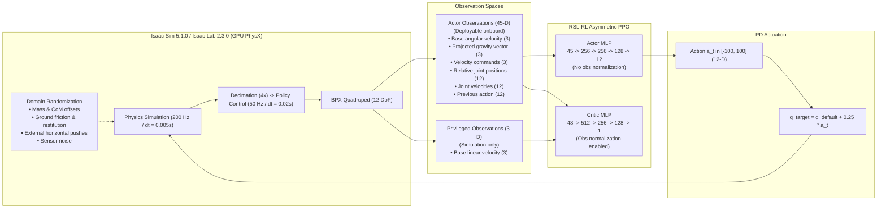

# BPX Quadruped Reinforcement Learning Methodology & Architecture

This document provides a comprehensive technical explanation of how reinforcement learning (RL) is formulated, structured, and trained for the **MIRRORME BPX** quadruped robot in [`mirrorme_rl_train`](https://github.com/mirrormerobotics/mirrorme_rl_train).

---

## 1. Executive Summary & Paradigm

The BPX quadruped RL pipeline uses **NVIDIA Isaac Lab 2.3.0** (built on Isaac Sim 5.1.0) and **RSL-RL 3.0.1** to train a flat-ground omnidirectional locomotion policy via **Asymmetric Actor-Critic Proximal Policy Optimization (PPO)**.



### Design Philosophy
Unlike frameworks that rely on recurrent networks (LSTM/GRU), heightfield elevation scanners, temporal history encoders, or proprietary state estimators (such as DWAQ/CENet), this setup uses a **lean, single-frame feed-forward policy**. The resulting Actor takes exactly 45 inputs and outputs 12 joint targets, making it simple, deterministic, and readily exportable to ONNX or TorchScript for real-time onboard inference.

---

## 2. Robot Specification & Physics Modeling

The robot articulation and actuator properties are defined in `resources/mirrorme.py`.

### 2.1 Kinematic Tree & Joint Order
The BPX quadruped possesses 12 actuated revolute degrees of freedom (3 joints per leg across 4 legs: Front-Left `fl`, Front-Right `fr`, Hind-Left `hl`, Hind-Right `hr`).

The environment strictly preserves the following **canonical joint order**:
1. `fl_hip_roll_joint`
2. `fr_hip_roll_joint`
3. `hl_hip_roll_joint`
4. `hr_hip_roll_joint`
5. `fl_hip_pitch_joint`
6. `fr_hip_pitch_joint`
7. `hl_hip_pitch_joint`
8. `hr_hip_pitch_joint`
9. `fl_knee_joint`
10. `fr_knee_joint`
11. `hl_knee_joint`
12. `hr_knee_joint`

### 2.2 Actuator Configuration (`ImplicitActuatorCfg`)
Actuators operate as simulated PD position drives:
* **Effort Limit ($\tau_{\max}$)**: $30.0\text{ Nm}$
* **Stiffness ($K_p$)**: $30.0$
* **Damping ($K_d$)**: $1.0$
* **Rotor Armature**: $0.003\text{ kg}\cdot\text{m}^2$

### 2.3 Nominal Default Pose
* Hip roll: $0.0\text{ rad}$
* Hip pitch: $0.8\text{ rad}$
* Knee: $-1.5\text{ rad}$
* Default root height: $0.48\text{ m}$ above the ground plane.

### 2.4 Simulation Rates
* **Physics timestep ($\Delta t_{\text{sim}}$)**: $0.005\text{ s}$ ($200\text{ Hz}$).
* **Decimation**: $4$, yielding a policy control step of $\Delta t = 0.02\text{ s}$ (**$50\text{ Hz}$**).
* **Parallel environments**: Default $4096$ environments on GPU.
* **Episode length**: $20.0\text{ s}$ ($1000$ policy steps).

---

## 3. Markov Decision Process (MDP)

The task configuration is defined in `source/mirrorme_rl_train/mirrorme_rl_train/tasks/locomotion/bpx_flat_env_cfg.py`.

### 3.1 Velocity Commands (`CommandsCfg`)
The policy learns omnidirectional velocity tracking in the base frame:
* Forward velocity: $v_x \in [-1.5, 1.5]\text{ m/s}$
* Lateral velocity: $v_y \in [-1.0, 1.0]\text{ m/s}$
* Yaw angular velocity: $\omega_z \in [-2.0, 2.0]\text{ rad/s}$
* **Command resampling**: Sampled uniformly every $5.0$ to $9.0$ seconds.
* **Standing probability (`rel_standing_envs = 0.20`)**: 20% of environments receive zero commands $(0, 0, 0)$ to train stable stationary stance without drifting or stepping in place.

### 3.2 Action Space (`ActionsCfg`)
The action $a_t \in \mathbb{R}^{12}$ represents **residual joint position setpoints**:

$$
q_{\text{target}} = q_{\text{default}} + 0.25 \times \text{clip}(a_t, -100, 100)
$$

Using residual actions centered on the default pose speeds up exploration and ensures that small initial network outputs keep the robot standing safely.

### 3.3 Observation Spaces (`ObservationsCfg`)

#### Deployable Actor Observations (45 Dimensions)
All terms are observable on physical hardware using onboard IMU and joint encoders:

| Index | Field | Dimension | Scale / Noise | Physical Meaning |
|---|---|---|---|---|
| `0:3` | `base_ang_vel` | 3 | $\times 0.25$, noise $\mathcal{U}(-0.2, 0.2)$ | Base gyroscope angular velocity $(\omega_x, \omega_y, \omega_z)$ |
| `3:6` | `projected_gravity` | 3 | noise $\mathcal{U}(-0.05, 0.05)$ | Gravity vector $R^T [0, 0, -1]^T$ in base frame |
| `6:9` | `velocity_commands` | 3 | $\times [2.0, 2.0, 0.25]$ | Desired $(v_x, v_y, \omega_z)$ command |
| `9:21` | `joint_pos_rel` | 12 | noise $\mathcal{U}(-0.01, 0.01)$ | Relative joint positions $q - q_{\text{default}}$ |
| `21:33` | `joint_vel_rel` | 12 | $\times 0.05$, noise $\mathcal{U}(-1.5, 1.5)$ | Joint velocities $\dot{q}$ |
| `33:45` | `last_action` | 12 | None | Previous action output $a_{t-1}$ |

#### Privileged Critic Observations (48 Dimensions)
The Critic value network $V(s)$ observes:
* All **45 Actor observation dimensions**, plus
* **Base linear velocity** $(v_x, v_y, v_z) \in \mathbb{R}^3$ obtained directly from simulator ground truth.

Because true linear velocity is difficult to measure without drift on real quadrupeds lacking external optical tracking, it is restricted to the Critic during simulation training (Asymmetric Actor-Critic).

---

## 4. Reward Terms & Motion Shaping

The reward function balances velocity tracking, body stability, natural gait generation, energy minimization, and safety:

### 4.1 Command Tracking
* **Linear Velocity Tracking (`track_lin_vel_xy_exp`, weight: $+2.0$)**:

  $$
  R_{\text{lin}} = \exp\left(-\frac{\|v_{\text{xy}} - v_{\text{xy}}^{\text{cmd}}\|^2}{0.40^2}\right)
  $$

* **Yaw Angular Velocity Tracking (`track_ang_vel_z_exp`, weight: $+1.0$)**:

  $$
  R_{\text{yaw}} = \exp\left(-\frac{(\omega_z - \omega_z^{\text{cmd}})^2}{0.40^2}\right)
  $$

### 4.2 Body Stability & Posture
* **Base Height (`base_height_l2`, weight: $-3.0$)**: Penalizes squared error between current torso height and target height ($0.48\text{ m}$).
* **Flat Orientation (`flat_orientation_l2`, weight: $-1.0$)**: Penalizes non-horizontal torso roll and pitch.
* **Vertical Velocity (`lin_vel_z_l2`, weight: $-1.0$)**: Penalizes vertical torso bouncing.
* **Roll/Pitch Velocity (`ang_vel_xy_l2`, weight: $-0.05$)**: Dampens roll and pitch rotations.

### 4.3 Foot Contacts & Gait Shaping
* **Feet Air Time (`quadruped_feet_air_time`, weight: $+0.25$)**: Rewards foot swing duration $(t_{\text{air}} - 0.35\text{ s})$ upon touchdown. BPX evaluates motion norm including yaw rate so turning in place properly rewards stepping.
* **Swing Foot Clearance (`swing_foot_clearance`, weight: $+0.04$)**: Rewards swing feet for lifting off the ground up to $0.05\text{ m}$ during commanded motion.
* **Foot Slipping (`feet_slide`, weight: $-0.20$)**: Penalizes tangential foot velocity during contact.
* **Excessive Contact Force (`feet_contact_force`, weight: $-2.0 \times 10^{-4}$)**: Penalizes foot impact forces exceeding $120\text{ N}$.
* **Undesired Contact (`undesired_leg_contacts`, weight: $-1.0$)**: Penalizes contact forces $>1.0\text{ N}$ on non-foot links (hips, thighs, calves).

### 4.4 Energy & Smoothness
* **Action Rate (`action_rate_l2`, weight: $-0.10$)**: Penalizes changes between consecutive actions $\|a_t - a_{t-1}\|^2$.
* **Mechanical Power (`joint_power_l1`, weight: $-2.0 \times 10^{-5}$)**: Penalizes $\vert \tau \cdot \dot{q} \vert$.
* **Joint Torques (`joint_torques_l2`, weight: $-1.0 \times 10^{-5}$)**: Penalizes squared actuator effort.
* **Joint Acceleration (`joint_acc_l2`, weight: $-2.0 \times 10^{-6}$)**: Penalizes high joint accelerations.
* **Leg Posture Deviation (`leg_posture_deviation_l1`, weight: $-0.12$)**: Encourages pitch and knee joints to remain near nominal walking pose, preventing unnatural straight-leg locking or deep crouching.
* **Standing Regularization (`stand_still`, weight: $-1.0$)**: Penalizes joint motion when commanded velocity is zero.

### 4.5 Terminations (`TerminationsCfg`)
Episodes terminate immediately upon:
* Simulation timeout ($20.0\text{ s}$).
* Torso ground impact (contact force $>5.0\text{ N}$ on `torso`).
* Severe tilt angle exceeding $65^\circ$ ($1.134\text{ rad}$).
* **Termination Penalty (`termination`, weight: $-200.0$)**: Imposes a heavy negative penalty on premature failure.

---

## 5. Sim-to-Real Domain Randomization

To guarantee robust transfer from Isaac Sim to physical hardware, perturbations are applied across environments:

1. **Ground Physics**:
   * Static friction: $\mathcal{U}(0.30, 1.50)$
   * Dynamic friction: $\mathcal{U}(0.20, 1.25)$
   * Restitution: $\mathcal{U}(0.0, 0.12)$
2. **Body Mass & Center of Mass (CoM)**:
   * Added torso mass: $\mathcal{U}(-1.0, 2.0)\text{ kg}$
   * Torso CoM displacement: $\pm 3\text{ cm}$ in $X$, $Y$, and $Z$.
3. **Reset State Disturbances**:
   * Root position: $\pm 0.5\text{ m}$; Yaw: $\pm \pi$
   * Root velocity: $\pm 0.25\text{ m/s}$ in $X/Y$, $\pm 0.10\text{ m/s}$ in $Z$, $\pm 0.18\text{ rad/s}$ in roll/pitch.
   * Joint positions scaled by $\mathcal{U}(0.90, 1.10)$ around default pose.
4. **External Horizontal Pushes**:
   * Applied at random intervals every $8.0$ to $15.0$ seconds.
   * Instantaneous linear velocity push: $\pm 0.60\text{ m/s}$ in $X$ and $Y$.
5. **Sensor Observation Noise**:
   * Injected onto angular velocity, gravity projection, joint positions, and joint velocities.

---

## 6. PPO Algorithm & Neural Architectures

Configured in `source/mirrorme_rl_train/mirrorme_rl_train/tasks/locomotion/agents/rsl_rl_ppo_cfg.py`:

| Parameter | Value | Details |
|---|---|---|
| **Actor Architecture** | `[256, 256, 128]` | MLP with ELU activations; output layer maps to 12 joints |
| **Critic Architecture** | `[512, 256, 128]` | MLP with ELU activations; output layer maps to scalar value $V(s)$ |
| **Observation Normalization** | Actor: `False`, Critic: `True` | Actor normalization is disabled to eliminate runtime drift on hardware |
| **Rollout Length** | `24` steps | $24 \times 4096 = 98,304$ samples collected per training iteration |
| **PPO Epochs** | `5` | Passes over collected rollout buffer per iteration |
| **Mini-batches** | `4` | Sub-batches per epoch |
| **Discount Factor ($\gamma$)** | `0.99` | Long-term return horizon |
| **GAE Parameter ($\lambda$)** | `0.95` | Generalized Advantage Estimation |
| **PPO Clip ($\epsilon$)** | `0.20` | Policy objective clipping |
| **Learning Rate** | `1e-3` (adaptive) | Dynamically scaled to maintain target KL divergence of $0.01$ |
| **Entropy Coefficient** | `0.01` | Encourages action space exploration |
| **Gradient Clipping** | `1.0` | Maximum gradient $L_2$ norm |

---

## 7. Project Tooling & Workflow Pipeline

The repository provides automated scripts managed by `./bpx.sh`:

```text
mirrorme_rl_train/
├── bpx.sh                     # Unified CLI entrypoint
├── resources/
│   ├── mirrorme.py            # Articulation & actuator configuration
│   └── BPX/                   # Robot URDF, meshes, and textures submodule
├── scripts/
│   ├── inspect_contract.py    # Runtime validation of 45-D/48-D/12-D interfaces
│   ├── train.py               # Parallelized PPO training runner
│   ├── play.py                # Visual checkpoint evaluation / rendering
│   └── export_policy.py       # TorchScript / ONNX model exporter
└── source/mirrorme_rl_train/
    └── mirrorme_rl_train/tasks/locomotion/
        ├── bpx_flat_env_cfg.py      # Scene, observations, rewards, terminations
        ├── agents/rsl_rl_ppo_cfg.py # Actor-Critic & PPO hyperparameters
        └── mdp/rewards.py           # Custom BPX reward terms
```

### Key Commands

* **Verify Contract**:
  ```bash
  ./bpx.sh contract --headless
  ```
  Confirms the 45-D Actor, 48-D Critic, and 12-D Action dimensional contract and joint ordering before training.

* **Launch Training**:
  ```bash
  ./bpx.sh train --task bpx_flat --num_envs 1024 --max_iterations 3000 --run_name baseline --headless
  ```

* **Interactive Evaluation**:
  ```bash
  ./bpx.sh play --checkpoint logs/bpx_flat/<RUN_FOLDER>/model_2999.pt
  ```

* **Export Deployment Policy**:
  ```bash
  ./bpx.sh export --checkpoint logs/bpx_flat/<RUN_FOLDER>/model_2999.pt
  ```
  Extracts the trained Actor network to:
  * `exported/bpx_flat_45.pt` (TorchScript format)
  * `exported/bpx_flat_45.onnx` (ONNX format, input `[batch, 45]`, output `[batch, 12]`)
