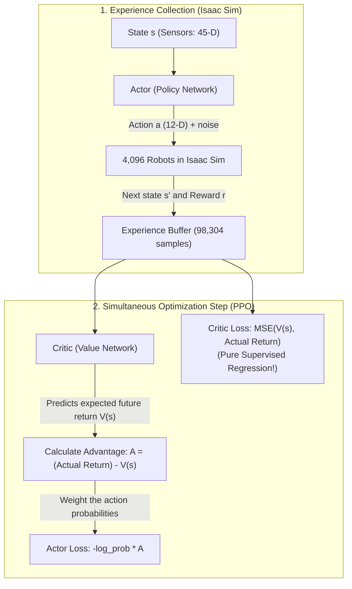

# Reinforcement Learning for Supervised Learning Engineers

A conceptual and mathematical bridge explaining how Actor-Critic Reinforcement Learning (PPO) works, using concepts and intuitions from Supervised Learning (SL).

---

## 1. The Core Mental Shift: SL vs. RL

If you are used to supervised computer vision, NLP, or tabular modeling, the biggest difference in RL is that **there are no fixed input-label pairs $(x, y)$** and **no fixed dataset on disk**.

| Concept | Supervised Learning (SL) | Quadruped RL in this Repo |
|---|---|---|
| **Input ($x$)** | Fixed features, image pixels, token embeddings | **Observation ($s$)**: A 45-number vector of sensor readings (IMU, joint encoders, user joystick commands). |
| **Output ($\hat{y}$)** | Predicted class or continuous regression target | **Action ($a$)**: A 12-number vector of target joint angles sent to the motor controllers. |
| **Ground Truth ($y$)** | Hand-annotated label or ground-truth scalar | **None exists!** Nobody knows the exact micro-radian motor angles needed at millisecond 412. |
| **Loss Function** | $L(\hat{y}, y)$, e.g. Cross-Entropy, MSE | **Reward Scorecard**: A mathematical function calculating how well the robot did (speed, balance, energy). |
| **Dataset** | Static dataset on disk (`train.csv`, `images/`) | **Dynamic simulation**: The policy controls 4,096 simulated robots in Isaac Sim to generate its own training data on the fly. |

---

## 2. If There Are No Labels ($y$), How Does the Network Learn?

In standard supervised regression, if your network predicts $\hat{y} = 12.5$ and the true label is $y = 10.0$, the gradient directly tells the weights: *"decrease the output"*.

In robotics, we cannot know the optimal target joint angle $y^*$. Instead, the algorithm relies on **trial and error guided by rewards**:

1. **Explore**: At state $s$, the Actor predicts mean joint targets $\mu_\theta(s)$, but adds small random Gaussian noise:
   $$a \sim \mathcal{N}(\mu_\theta(s), \sigma^2)$$
2. **Step**: The robot executes action $a$ in Isaac Sim.
3. **Score**: The environment computes a scalar reward $R$ (e.g. $+2.0$ for matching speed, $-200.0$ if it trips and falls).
4. **Update**:
   * If the outcome was **better than expected**, take a gradient step that makes action $a$ **more likely** when visiting state $s$ again.
   * If the outcome was **worse than expected**, take a gradient step that makes action $a$ **less likely**.

Mathematically, the policy gradient looks very much like a weighted classification loss:
$$\nabla_\theta \mathcal{L}_{\text{actor}} \approx -\sum \nabla_\theta \log \pi_\theta(a \mid s) \times \underbrace{\text{Advantage}}_{\text{"How much better than average was this action?"}}$$

---

## 3. Why Are There Two Networks? (Actor vs. Critic)

Rather than training a single network, PPO uses two networks that learn alongside each other during every iteration:



### The Critic is Pure Supervised Regression
* **Input**: The state $s$ (48 dimensions, including privileged simulator ground truth).
* **Output**: A single scalar $V(s)$ estimating the total discounted points the robot is expected to collect from state $s$ until the end of the episode.
* **Training Objective**: Standard **Mean Squared Error (MSE)** against the actual cumulative returns observed in the simulator:
  $$\mathcal{L}_{\text{critic}} = \frac{1}{2} \left( V_\phi(s) - R_{\text{actual}} \right)^2$$
  The Critic is literally a supervised regression model predicting the robot's future score.

### The Actor is the Controller
* **Input**: The deployable state $s$ (45 dimensions from real sensors).
* **Output**: The 12 target motor positions.
* **Training Objective**: Maximize the probability of actions that yielded a positive **Advantage**:
  $$\text{Advantage} = \text{Actual Score Received} - \text{Score the Critic Predicted}$$

---

## 4. Why Do We Need the Critic? (Variance Reduction)

You might wonder: *"Why not just use the raw reward points directly to train the Actor? Why bother training the Critic?"*

The answer is **credit assignment under high variance**:

* **Scenario Without a Critic**:
  Suppose the robot was violently pushed and is already upside down mid-air. Even if the Actor executes the *best possible recovery action*, the robot still crashes and gets a terrible score of $-180$.
  Without a Critic, the algorithm assumes: *"Score was negative, so whatever action you just did was bad! Never do it again!"* The Actor is unfairly penalized for doing the right thing in a hopeless situation.

* **Scenario With a Critic**:
  The Critic evaluates the upside-down state and predicts: *"From this terrible position, you normally get $-200$ points."*
  Because the Actor's recovery action resulted in $-180$ points, the Advantage is:
  $$\text{Advantage} = (-180) - (-200) = \mathbf{+20}$$
  The algorithm recognizes: *"Even though the total score was low, this action was $+20$ points better than baseline!"* The Actor is correctly rewarded.

The Critic serves as a **dynamic baseline** that removes state-dependent bias and dramatically reduces variance.

---

## 5. Are Actor and Critic Trained Simultaneously on the Same Loss?

**Yes, both networks are updated in the same training loop, but their weights are completely independent.**

In multi-task supervised learning, you might train a model with a composite loss like $L_{\text{total}} = L_{\text{classification}} + L_{\text{bounding\_box}}$. PPO does something very similar:

$$\mathcal{L}_{\text{total}} = \underbrace{\mathcal{L}_{\text{actor}}(\theta)}_{\text{depends ONLY on Actor } \theta} + c_1 \cdot \underbrace{\mathcal{L}_{\text{critic}}(\phi)}_{\text{depends ONLY on Critic } \phi} - c_2 \cdot \underbrace{\mathcal{H}(\theta)}_{\text{Entropy bonus}}$$

### Why Gradients Do Not Interfere
The Actor and Critic have completely separate neural network weights:
* **Actor parameters ($\theta$)**: $45 \to 256 \to 256 \to 128 \to 12$
* **Critic parameters ($\phi$)**: $48 \to 512 \to 256 \to 128 \to 1$

When PyTorch executes `total_loss.backward()`:
1. For Critic weights $\phi$:
   $$\frac{\partial \mathcal{L}_{\text{total}}}{\partial \phi} = c_1 \frac{\partial \mathcal{L}_{\text{critic}}}{\partial \phi} + 0$$
   The Actor's performance has **zero mathematical effect** on the Critic's weight updates.
2. For Actor weights $\theta$:
   $$\frac{\partial \mathcal{L}_{\text{total}}}{\partial \theta} = \frac{\partial \mathcal{L}_{\text{actor}}}{\partial \theta} - c_2 \frac{\partial \mathcal{H}}{\partial \theta} + 0$$
   The Critic's MSE loss has **zero mathematical effect** on the Actor's weight updates.

### The Crucial `.detach()` Guardrail
Notice that the Advantage formula uses the Critic's prediction:
$$\text{Advantage} = R_{\text{actual}} - V_\phi(s)$$

If you directly plugged this into the Actor loss, backpropagation through the Actor loss would attempt to alter the Critic's weights to make the advantage bigger, corrupting the Critic!

To prevent this, RSL-RL explicitly **detaches** the Critic's values:
```python
# Critic predicts expected future return
value_pred = critic(critic_observations)

# The advantage is detached as a fixed numerical scalar:
advantage = (returns - value_pred).detach()

# The Actor treats the advantage strictly as a constant weighting factor:
actor_loss = -(log_prob * advantage).mean()
```

---

## 6. What is "Asymmetric Actor-Critic"?

In supervised learning, your training features and test features must match. 

In RL, we exploit an asymmetric setup:
* **The Critic** only exists on your training GPU. It is never deployed to the physical robot. Therefore, we give it "cheat codes" from the physics engine: ground-truth base linear velocity $(v_x, v_y, v_z)$, expanding its input to 48 dimensions. This helps the Critic accurately evaluate states.
* **The Actor** is the network that actually runs on the robot. It is strictly limited to 45 real-world sensor measurements (IMU angular velocity, gravity projection, joint encoder angles and velocities, previous action, and user velocity commands).

At deployment time, **the Critic is discarded**. Only the 45 $\to$ 12 Actor network is exported to ONNX / TorchScript.

---

## 7. Parallel Environments as Batch Generation

In supervised learning, you load a static mini-batch (e.g. 64 or 256 images) from disk.

In RL, because training data must be generated dynamically:
* Running 1 robot in simulation would take ~33 minutes of real time just to collect 100,000 steps.
* If that 1 robot falls over, all subsequent data for the next 20 seconds is uninformative noise.

By running **4,096 robots simultaneously on the GPU**:
* In just **24 simulation steps** (about 0.48 seconds of simulated time), the system collects:
  $$4,096 \text{ robots} \times 24 \text{ steps} = 98,304 \text{ transitions}$$
* This provides a massive, diverse batch capturing robots walking, turning, falling, recovering, and standing still.
* The system runs 5 epochs of SGD/Adam on this batch, updates both Actor and Critic, discards the data, and collects a fresh batch with the newly improved policy.


---

## 8. What is RSL-RL and Where Does It Fit in the Stack?

**RSL-RL** is an open-source, GPU-native reinforcement learning library developed by the **Robotic Systems Lab (RSL)** at **ETH Zürich** (the robotics lab behind the ANYmal quadruped).

To understand where it sits in relation to supervised learning tools:

| Role | Supervised Learning Equivalent | Quadruped Training Stack | Responsibility in this Repo |
|---|---|---|---|
| **Physics / Data Source** | Camera sensor / Raw image dataset | **NVIDIA Isaac Sim 5.1.0** (PhysX) | Simulates the 3D world, gravity, ground contacts, and joint dynamics. |
| **Environment Wrapper** | PyTorch `Dataset` / `DataLoader` | **Isaac Lab 2.3.0** (`ManagerBasedRLEnv`) | Formats the 45-D sensor tensors, computes reward terms, and applies domain randomizations. |
| **Training Engine** | Hugging Face `Trainer` / PyTorch Lightning | **RSL-RL 3.0.1** (`OnPolicyRunner`) | Manages the Actor-Critic networks, maintains the on-GPU rollout buffer, and runs PPO gradient updates. |
| **Compute Backend** | PyTorch / CUDA | PyTorch / CUDA | Tensor algebra, automatic differentiation, and GPU kernels. |

### Why Not General RL Libraries (like Stable-Baselines3 or Ray)?
General RL libraries were architected for CPU-based simulation (like Atari or MuJoCo), where copying data between CPU RAM and GPU VRAM over the PCIe bus becomes a massive bottleneck for thousands of parallel agents.

**RSL-RL is 100% on-GPU (Zero-Copy):**
* Simulator states, observations, neural networks, experience buffers, and the Adam optimizer **never leave GPU VRAM**.
* It processes **200,000 to 500,000 environment steps per second** on a single GPU (like an NVIDIA L4 or RTX 4090).
* A walking gait that used to require days of CPU training converges in **15 to 30 minutes**.

---

## 9. Log-Probabilities in Continuous Action MLPs: From Transformer Softmax to Gaussians

In a Transformer, the action space is **discrete** (a vocabulary of tokens). In robotics, the action space is **continuous** (12 motor target angles, which are real numbers like $-1.482\text{ rad}$).

How do we compute **log-probabilities** ($\log \pi(a \mid s)$) for a simple fully connected MLP?

### 9.1 The Transformer vs. Continuous Actor Comparison

| Concept | Transformer (Discrete Vocabulary) | Continuous Actor MLP (12 Motors) |
|---|---|---|
| **Underlying Distribution** | **Categorical Distribution** over tokens | **Multivariate Gaussian (Normal)** $\mathcal{N}(\boldsymbol{\mu}, \boldsymbol{\sigma}^2)$ |
| **Network Output** | Unnormalized logits $\mathbf{z} \in \mathbb{R}^{V}$ | **Mean vector $\boldsymbol{\mu} \in \mathbb{R}^{12}$** (12 target joint angles) |
| **Spread / Temperature** | Softmax temperature $T$ | **Learnable standard deviation $\boldsymbol{\sigma} \in \mathbb{R}^{12}$** |
| **Sampling an Action** | `torch.multinomial(softmax(z))` $\to$ Token ID | $\mathbf{a} = \boldsymbol{\mu} + \boldsymbol{\sigma} \odot \boldsymbol{\epsilon}, \quad \boldsymbol{\epsilon} \sim \mathcal{N}(0, \mathbf{I})$ |
| **Log Probability** | Cross-entropy: $\log \left( \frac{e^{z_i}}{\sum e^{z_j}} \right)$ | **Gaussian log-likelihood formula** (analytical quadratic form) |

### 9.2 The Mathematical Formula
For a single motor joint with predicted mean $\mu$ and standard deviation $\sigma$, the probability density of executing action $a$ is:

$$p(a) = \frac{1}{\sqrt{2\pi\sigma^2}} \exp\left( -\frac{(a - \mu)^2}{2\sigma^2} \right)$$

Taking the natural logarithm:

$$\log p(a) = -\frac{1}{2} \left[ \frac{(a - \mu)^2}{\sigma^2} + 2\log\sigma + \log(2\pi) \right]$$

For all 12 independent motor joints, the total log-probability is the sum across joints:

$$\log \pi(\mathbf{a} \mid \mathbf{s}) = \sum_{i=1}^{12} \log p(a_i \mid \mu_i, \sigma_i)$$

Notice the term $(a - \mu)^2$:
* It is simply the **squared error (MSE)** between the sampled exploration action $a$ and the network's predicted mean $\mu$.
* When the Advantage is **positive** ($+A$), maximizing the objective pulls the network's mean $\mu$ **closer to the action $a$** that yielded the reward.
* When the Advantage is **negative** ($-A$), the gradient pushes $\mu$ **away** from that action.

### 9.3 PyTorch Implementation in Code
Inside RSL-RL and PyTorch, this is implemented cleanly using `torch.distributions.Normal`:

```python
import torch
import torch.nn as nn
from torch.distributions import Normal

class ActorCritic(nn.Module):
    def __init__(self):
        super().__init__()
        # Standard fully connected MLP: 45 -> 256 -> 256 -> 128 -> 12
        self.actor_backbone = nn.Sequential(
            nn.Linear(45, 256), nn.ELU(),
            nn.Linear(256, 256), nn.ELU(),
            nn.Linear(256, 128), nn.ELU(),
            nn.Linear(128, 12)  # Outputs the 12 MEANS (mu)
        )
        
        # Learnable log standard deviation parameter vector (one per motor)
        # Initialized via init_noise_std = 1.0 in rsl_rl_ppo_cfg.py
        self.log_std = nn.Parameter(torch.zeros(12))

    def forward(self, observations):
        # 1. MLP outputs mean motor positions
        mu = self.actor_backbone(observations)
        
        # 2. Convert log_std to positive standard deviations
        sigma = torch.exp(self.log_std)
        
        # 3. Parameterize the Gaussian distribution
        dist = Normal(mu, sigma)
        
        # 4. Sample action (with exploration jitter) during training:
        action = dist.sample() 
        
        # 5. Compute the log-probability of the sampled action:
        # This is the exact log_prob used in the PPO loss!
        log_prob = dist.log_prob(action).sum(dim=-1)
        
        return action, log_prob
```

### 9.4 What Happens at Deployment Time on the Real Robot?
* During training, stochastic sampling ($\sigma$) is essential for discovering effective walking gaits.
* At deployment time, **we discard $\sigma$ and sampling entirely**.
* The exported model (`bpx_flat_45.onnx` / `bpx_flat_45.pt`) is purely a **deterministic feed-forward MLP**:
  $$\mathbf{q}_{\text{target}} = \mathbf{q}_{\text{default}} + 0.25 \times \text{MLP}_{\text{Actor}}(\text{Sensors})$$
* It takes the 45 sensor readings and directly outputs the 12 deterministic mean joint targets at 50 Hz.
